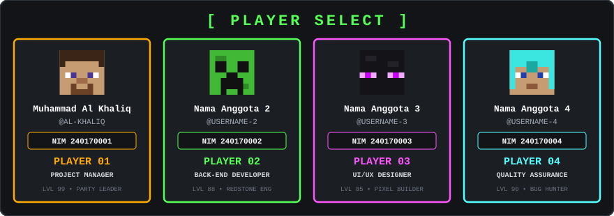
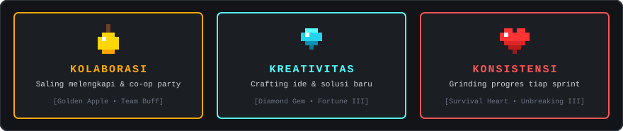
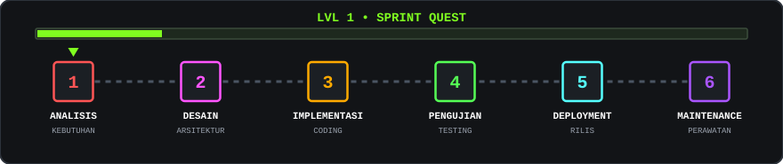

#  Ayam Geprek Pedas

> *"Software yang hebat lahir dari tim yang saling percaya dan terus membangun blok demi blok."*

---

##  Player Select

  

---

##  Power-Ups

  

---

##  Level Select

  Setiap proyek melewati enam level siklus hidup pengembangan perangkat lunak (SDLC).

  

---

##  Inventory Dokumen Sprint 1

| Slot | Dokumen | Deskripsi |
| :---: | :--- | :--- |
| `01` | [Profil Kelompok](Sprint-1/profil-kelompok.md) | Identitas party pengembang dan pembagian peran |
| `02` | [Profil Project](Sprint-1/profil-project.md) | Latar belakang masalah, tujuan sistem, dan tech stack |
| `03` | [Project Charter](Sprint-1/project-charter.md) | Ruang lingkup, jadwal sprint, dan mitigasi risiko |