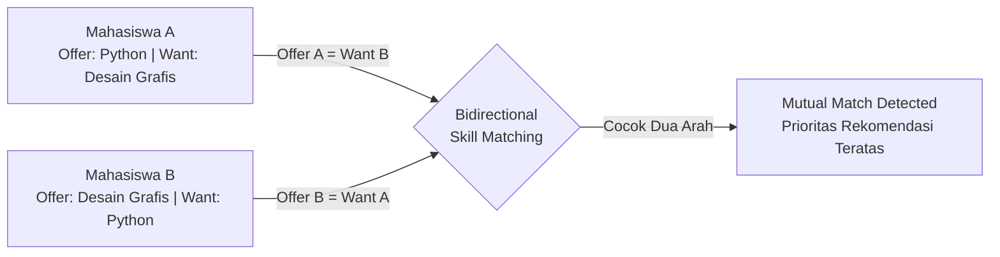
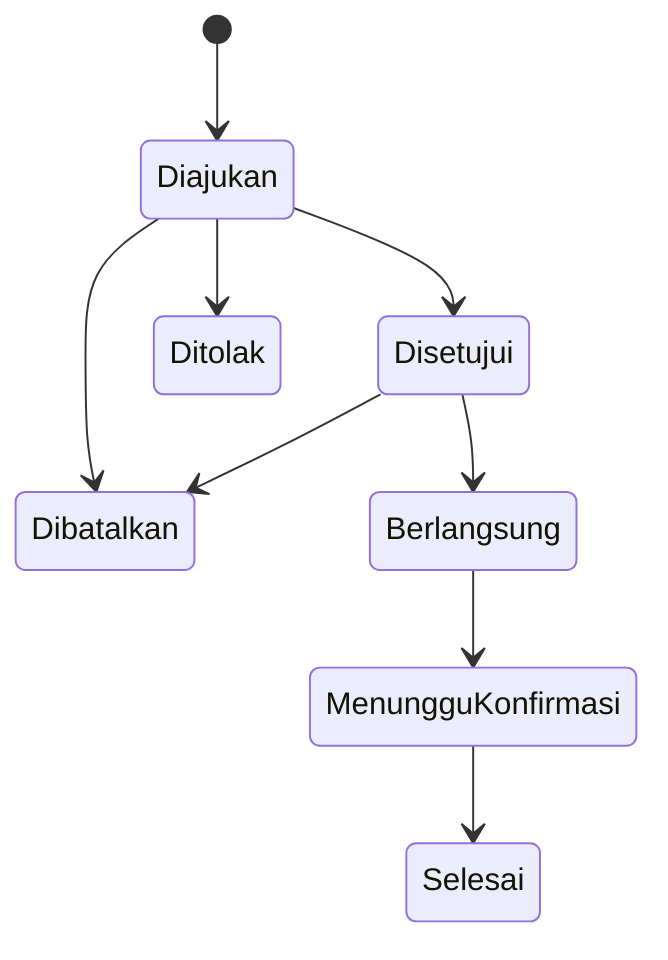
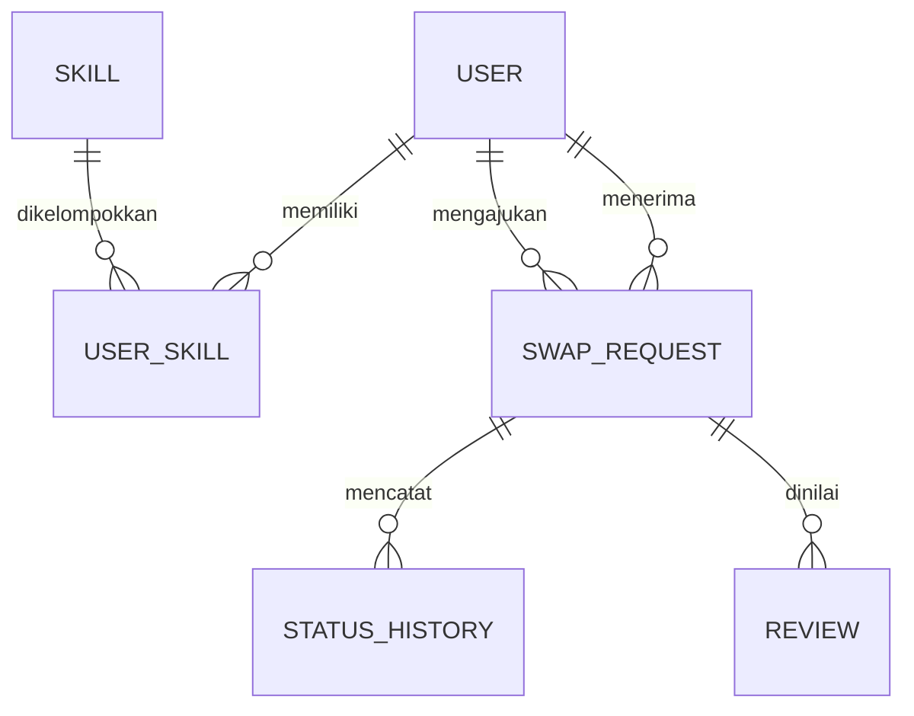

# 📘 Profil Project: Skill Swap

## Identitas

| Item | Keterangan |
| :--- | :--- |
| **Nama project** | Skill Swap |
| **Jenis** | Aplikasi web platform pertukaran keahlian (*skill barter*) antarmahasiswa |
| **Metode pengembangan** | Agile Scrum |

## Latar Belakang

Banyak mahasiswa memiliki keahlian tertentu di bidang akademik maupun nonakademik, seperti pemrograman Python, desain grafis, penyuntingan video, analisis data, atau bahasa asing. Di sisi lain, banyak mahasiswa lain yang ingin mempelajari keahlian tersebut namun terkendala biaya kursus atau tidak memiliki rekan belajar yang tepat. Pencarian partner belajar yang dilakukan secara informal (melalui pesan pribadi atau grup chat) rentan menimbulkan masalah: **informasi keahlian tidak terstruktur, sulit menemukan kecocokan belajar dua arah, jadwal pertukaran tidak jelas, serta tidak adanya rekam jejak kepercayaan antaranggota**.

## Tujuan

Mengelola proses pertukaran keahlian antarmahasiswa secara terstruktur dan terukur, mulai dari pendaftaran profil keahlian, pencocokan partner otomatis, pengajuan pertukaran, persetujuan, pelaksanaan sesi belajar, hingga pencatatan riwayat dan ulasan.

## Ruang Lingkup

| Termasuk (versi awal) | Di luar cakupan (versi awal) |
| :--- | :--- |
| Registrasi, login (JWT), dan pengelolaan profil mahasiswa | Fitur *video conference* atau panggilan suara terintegrasi |
| Manajemen daftar keahlian dikuasai (*Offered*) dan dicari (*Wanted*) | Integrasi gerbang pembayaran (*payment gateway*) |
| Pencarian pengguna berdasarkan nama atau kategori keahlian | Aplikasi *mobile* native (Android / iOS) |
| Sistem rekomendasi partner otomatis (*Bidirectional Skill Matching*) | Sistem sertifikasi resmi berbayar |
| Pengajuan pertukaran, persetujuan/penolakan, dan konfirmasi selesai | Moderasi konten berbasis kecerdasan buatan (AI) eksternal |
| Riwayat pertukaran keahlian, rating, dan ulasan pengguna | |

Versi awal membatasi **satu permintaan pertukaran aktif antara dua pengguna yang sama untuk kombinasi keahlian tertentu** agar tidak terjadi duplikasi pengajuan.

## Pengguna dan Hak Akses

| Pengguna | Hak akses utama |
| :--- | :--- |
| **Pemilik Keahlian (*Mentor*)** | Mendaftarkan keahlian yang dikuasai beserta tingkat kemahirannya, menerima atau menolak permintaan pertukaran masuk, serta mengonfirmasi selesainya sesi pembelajaran |
| **Pencari Keahlian (*Learner*)** | Mendaftarkan keahlian yang ingin dipelajari, mencari partner, melihat rekomendasi kecocokan, mengajukan permintaan pertukaran, serta memberikan rating dan ulasan |
| **Administrator** | Memoderasi akun dan daftar keahlian pengguna, mengelola kategori keahlian, serta memantau ringkasan aktivitas pertukaran pada sistem |

Seorang mahasiswa dapat berperan sebagai **Pemilik Keahlian** sekaligus **Pencari Keahlian** secara bersamaan; perannya ditentukan oleh hubungan keahlian pada masing-masing transaksi pertukaran.

## Fitur Utama

1. **Registrasi dan Login:** Pembuatan akun mahasiswa dan autentikasi pengguna menggunakan token JWT.
2. **Profil Pengguna:** Pengelolaan biodata mahasiswa, program studi, bio singkat, dan ketersediaan waktu belajar.
3. **Daftar Keahlian (*Skill Inventory*):** Pencatatan keahlian yang ditawarkan (*Skills Offered*) dan keahlian yang ingin dipelajari (*Skills Wanted*).
4. **Pencarian Berdasarkan Keahlian:** Pencarian dan penyaringan profil mahasiswa berdasarkan kata kunci atau kategori keahlian.
5. **Sistem Rekomendasi Partner (*Skill Matching*):** Menampilkan daftar kandidat partner paling relevan berdasarkan kecocokan keahlian dua arah.
6. **Pengajuan Pertukaran Keahlian:** Mengirim permintaan barter keahlian dengan menentukan keahlian yang ditukar dan catatan jadwal belajar.
7. **Persetujuan Permintaan & Manajemen Status:** Penerimaan, penolakan, pembatalan, hingga konfirmasi penyelesaian pertukaran dengan aturan perpindahan status yang jelas.
8. **Rating dan Ulasan:** Pemberian skor bintang ($1$–$5$) dan ulasan tertulis setelah transaksi pertukaran berstatus selesai.

## Inti Teknis

### 1. Algoritma *Bidirectional Skill Matching* di Sisi Server
Sistem mengevaluasi irisan data antara keahlian yang ditawarkan dan dicari oleh pengguna aktif ($U_1$) dengan pengguna lain ($U_2$). Kecocokan penuh (*Mutual Match*) terjadi apabila keahlian yang dikuasai $U_1$ dibutuhkan oleh $U_2$, dan sekaligus keahlian yang dikuasai $U_2$ dibutuhkan oleh $U_1$:

$$\text{MutualMatch}(U_1, U_2) \iff \big(\text{Offered}(U_1) \cap \text{Wanted}(U_2) \neq \emptyset\big) \land \big(\text{Wanted}(U_1) \cap \text{Offered}(U_2) \neq \emptyset\big)$$

### 2. Manajemen Status Pertukaran (*State Transition*)
Setiap pengajuan pertukaran memiliki siklus status yang divalidasi di sisi server untuk mencegah perubahan status yang tidak sah atau pengajuan ganda:

## Rancangan Data Awal

Rancangan awal ini dapat disempurnakan saat Sprint Planning.

## Teknologi (rencana)

| Lapisan | Pilihan |
| :--- | :--- |
| **Antarmuka (*Frontend*)** | React, HTML, CSS, JavaScript |
| **Server & API (*Backend*)** | Node.js + Express |
| **Autentikasi & Keamanan** | JSON Web Token (JWT) |
| **Basis Data (*Database*)** | MySQL |
| **Kolaborasi & Manajemen Kode** | Git, GitHub (Repository, Commits, Pull Request) |

## Contoh Alur Penggunaan

1. **Mahasiswa A** mendaftarkan profil keahliannya: menguasai **Python** (*Skills Offered*) dan ingin belajar **Desain Grafis** (*Skills Wanted*).
2. **Mahasiswa B** mendaftarkan profil keahliannya: menguasai **Desain Grafis** (*Skills Offered*) dan ingin belajar **Python** (*Skills Wanted*).
3. Sistem menjalankan algoritma **Skill Matching** di server dan menampilkan profil Mahasiswa B pada halaman rekomendasi milik Mahasiswa A (dan sebaliknya) sebagai *Mutual Match*.
4. **Mahasiswa A** mengajukan permintaan pertukaran keahlian kepada Mahasiswa B; status transaksi tercatat sebagai *Diajukan*.
5. **Mahasiswa B** menyetujui permintaan tersebut sehingga status berubah menjadi *Disetujui*, lalu menjadi *Berlangsung* saat sesi belajar dimulai.
6. Setelah sesi pertukaran selesai, kedua pihak mengonfirmasi penyelesaian hingga status berubah menjadi *Selesai*.
7. Kedua mahasiswa saling memberikan **rating dan ulasan** yang tersimpan pada riwayat profil masing-masing.